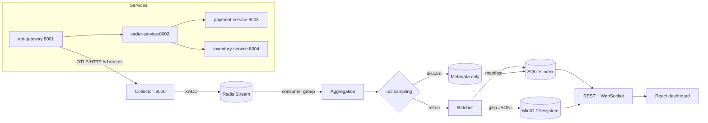

> **Render deployment:** For PostgreSQL-backed Render hosting, use [`RENDER_DEPLOYMENT.md`](RENDER_DEPLOYMENT.md) and the included `render.yaml`. The original README below documents the legacy local Docker Compose/SQLite setup; it remains available for reference and local tests.

# TraceFlow

**Distributed tracing & telemetry intelligence, running entirely on your machine.**

TraceFlow is a telemetry pipeline and observability console. Four simulated microservices
emit OpenTelemetry spans over OTLP/HTTP; a FastAPI collector buffers them in Redis Streams,
aggregates them into traces, applies tail-based sampling, compresses retained traces into
gzip JSONL batches, uploads those batches to MinIO, and indexes searchable metadata in
SQLite. The React dashboard reads its data from those services.

---

## Quick start (local Python + Node)

Prerequisites: Python 3.11, Node 20+, and optionally Redis and MinIO. If Redis or MinIO is
unavailable the collector starts anyway and logs which fallback it selected (`memory`
stream, `filesystem` object store).

```bash
# 1. Collector
cd backend
python -m venv .venv
./.venv/Scripts/python.exe -m pip install -r requirements.txt   # Windows
# source .venv/bin/activate && pip install -r requirements.txt  # macOS / Linux
./.venv/Scripts/python.exe -m uvicorn app.main:app --port 8000

# 2. Dashboard (second terminal)
cd frontend
npm install
npm run dev            # http://localhost:5173
```

The Vite dev server proxies `/api` (including the WebSocket) and `/v1` to
`http://127.0.0.1:8000`, so the browser only ever talks to its own origin.

Generate traffic:

```bash
# Synthetic traces straight into the collector (150 traces ≈ 600 spans)
curl -X POST http://localhost:8000/api/telemetry/traffic \
  -H 'content-type: application/json' \
  -d '{"traces":150,"error_probability":0.12,"slow_probability":0.15}'
```

Or start the four simulated services and drive the real HTTP flow:

```bash
cd backend
./.venv/Scripts/python.exe -m uvicorn app.services.gateway.main:app  --port 8001
./.venv/Scripts/python.exe -m uvicorn app.services.order.main:app    --port 8002
./.venv/Scripts/python.exe -m uvicorn app.services.payment.main:app  --port 8003
./.venv/Scripts/python.exe -m uvicorn app.services.inventory.main:app --port 8004

curl -X POST http://localhost:8001/checkout
```

## Quick start (Docker Compose)

```bash
cp .env.example .env
docker compose up --build
```

| Service | URL |
| --- | --- |
| Dashboard (nginx) | http://localhost:5173 |
| Collector API + `/api/docs` | http://localhost:8000 |
| Gateway (traffic entry point) | http://localhost:8001/checkout |
| Redis | localhost:6379 |
| MinIO API / console | localhost:9000 / http://localhost:9001 |

Compose starts Redis and MinIO with health checks, waits for the collector to report
`/api/health`, then starts the four demo services (each exporting OTLP to
`http://collector:8000`) and the built dashboard. Batches and the SQLite index persist in
the `collector-data` volume; Redis and MinIO keep their own volumes.

Optional load test (Locust, headless for 60 s):

```bash
docker compose --profile load run --rm locust
```

## The console

| Page | What it shows |
| --- | --- |
| **Overview** | Live totals, error rate, latency percentiles, sampling rate, throughput, performance chart, service health, recent traces and events |
| **Live Traces** | Trace tail refreshed every 2.5 s with pause/filter, ingest counters, buffer depth, worker states |
| **Trace Explorer** | Server-side filtering by trace ID, service, operation, status, duration and time range, with sorting and pagination |
| **Trace detail** | Metadata, sampling decision, duration waterfall, span attributes/events, link to the storage batch |
| **Service Map** | Graph built from observed parent→child service edges, inbound/outbound calls, top operations |
| **Telemetry Pipeline** | Stage-by-stage counters and latency for ingest → Redis → aggregation → sampling → batching → MinIO → SQLite |
| **Sampling Engine** | Live policy editor, retention/discard breakdown, storage-reduction estimate, recent decisions |
| **Storage & Indexing** | Compressed-vs-raw bytes, batch table with retry, batching policy, object inspection, SQLite indexes |
| **Fault Injection** | Six real failure scenarios with recovery verification and persisted run timelines |
| **Benchmarks** | Measured ingestion throughput, latency percentiles, storage cost, and sampling/batching/outage/concurrency experiments |

## How it works



Key behaviours:

- **Bounded buffering.** Spans enter a Redis Stream with a max length. If Redis is
  unavailable, ingestion spills to a bounded in-process queue instead of growing unbounded,
  and drains it when the buffer returns.
- **Idempotent ingestion.** Span IDs are recorded on ingest, so replayed or duplicated
  telemetry is deduplicated and never persisted twice.
- **Tail-based sampling.** A trace is decided only after it stops receiving spans
  (completion timeout). Error traces and traces above the slow threshold are always kept;
  successful traces are sampled deterministically by trace-ID hash. Late spans follow the
  configured policy (`drop` or `accept_if_buffered`).
- **Two-tier storage.** SQLite holds searchable metadata only. Span bodies live in
  compressed batch objects; opening a trace fetches and decompresses its batch.
- **Recovery.** Every fault scenario runs against this process and reports counters
  measured during the run.

## Verification

```bash
cd backend
./.venv/Scripts/python.exe -m pytest        # 27 tests
cd ../frontend
npm run build                               # production bundle
```

The test suite covers OTLP protobuf decoding, aggregation into traces, sampling decisions,
deduplication, batching/compression, object storage, API filtering, fault recovery and
benchmark runs.

## Scope

TraceFlow is a single-node, local-first system built for learning and demonstration. It is
not a production APM. SQLite is a metadata index, not a time-series database; sampling
decisions are per-process; the fault lab simulates failures in-process rather than killing
containers; and the benchmark runner measures this machine.


### Render automatic demo telemetry

The Render Blueprint opts in to `AUTO_DEMO_ENABLED=true`. On startup the collector emits 24 synthetic traces and then generates 1 every 15 seconds via the normal ingestion → sampling → index → compressed storage pipeline. The Overview shows a **Demo Mode · Simulated Data** label; these are *not* genuine production requests. It can be disabled with `AUTO_DEMO_ENABLED=false`. See `RENDER_DEPLOYMENT.md` for GitHub update steps and free-tier storage limitations.
