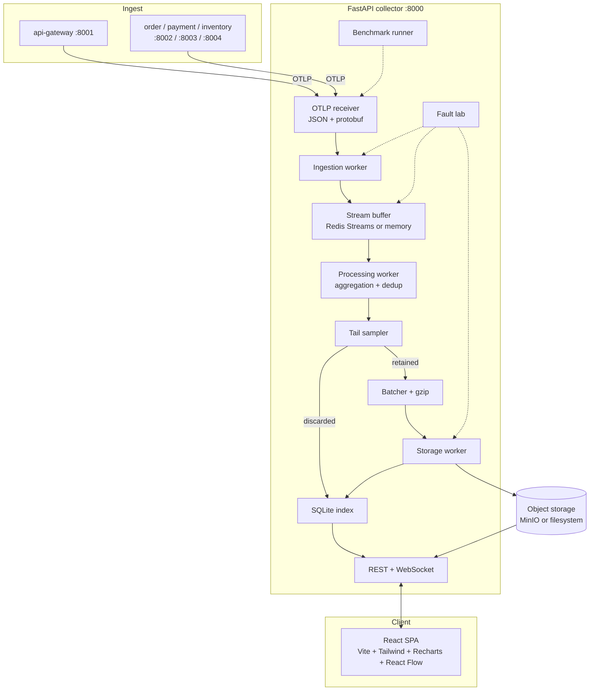
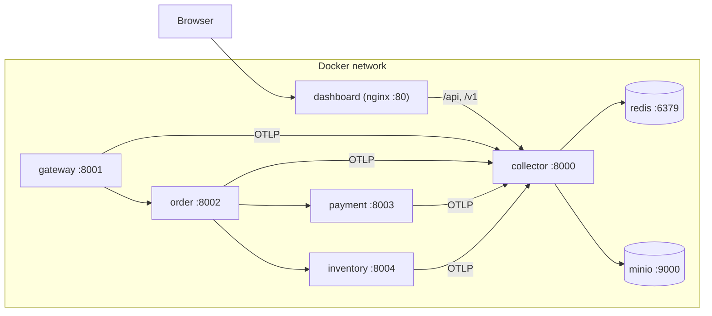

# Architecture

TraceFlow is one Python process (the collector), four small FastAPI services, and a static
React bundle. Everything runs on one machine; Compose only packages the same pieces.

## Components

| Component | Responsibility | Where |
| --- | --- | --- |
| OTLP receiver | Accepts `/v1/traces` as OTLP JSON or protobuf, normalises resource/span attributes | `app/api/routes/telemetry.py`, `app/schemas/telemetry.py` |
| Ingestion worker | Validates spans, records span IDs for dedup, XADDs to the stream, spills when the buffer is down | `app/collector/ingestion.py`, `app/buffers/stream.py` |
| Processing worker | Buffers open traces until a completion timeout, then aggregates spans into one trace record | `app/collector/aggregation.py` |
| Tail sampler | Keeps errors, keeps slow traces, hashes success traces for deterministic sampling | `app/collector/sampling.py` |
| Batcher | Groups retained traces, writes gzip JSONL, records a batch manifest | `app/collector/batching.py`, `compression.py` |
| Storage worker | Uploads batches, retries with backoff, marks failures recoverable | `app/collector/recovery.py`, `app/storage/object_store.py` |
| Index | SQLite metadata + query paths for traces, services, edges, batches, events, metrics | `app/storage/indexing.py`, `schema.py` |
| Fault lab | Runs six bounded failure scenarios and verifies recovery from live counters | `app/collector/faults.py` |
| Benchmark runner | Generates traffic, waits for the pipeline to drain, reads measured results back | `app/services/benchmarks.py` |
| Live feed | WebSocket pushing a fresh overview snapshot every ~3 s | `app/api/routes/live.py` |

## Why these choices

**Redis Streams as the buffer.** A stream gives consumer groups, acknowledgements, pending
message visibility and bounded length in one primitive, so replayed spans and crash recovery
are testable (`XAUTOCLAIM` on startup). The in-memory fallback implements the same small
interface, which is what lets the collector start on a laptop without Redis.

**Aggregate before storing.** Spans arrive interleaved from four services. Aggregation keyed
by trace ID turns them into the unit the UI actually needs — one trace with a duration,
status, span count and service set — so searching does not require scanning span bodies.

**Two-tier storage.** SQLite answers "which traces match these filters" quickly. Span bodies
are large and only needed when a single trace is opened, so they live in compressed batch
objects fetched on demand. The Storage page shows both the index size and the compressed
object bytes, which is why the compression numbers there are real.

**Sampling at the tail.** Head sampling would discard traces before their outcome is known;
the interesting traces (errors, slowness) are only identifiable after they finish. The
sampler therefore waits for the completion timeout and then decides. The cost is memory for
open traces, bounded by the same timeout.

**Deterministic success sampling.** Sampled decisions use a stable hash of the trace ID, so
the same trace always produces the same decision. That makes tests reproducible and avoids
flip-flopping when a trace is re-evaluated.

## Concurrency

Five asyncio workers run inside the collector: ingestion, processing, storage, spill and
metrics/snapshot. Each has a supervisor (`app/workers/base.py`) that records restarts, last
errors and uptime, which is what the Pipeline page and `/api/telemetry/stats` report. A
worker crash is visible rather than silent.

## Deployment topology

The dashboard container is a plain nginx static server; it proxies `/api` and `/v1` to the
collector, including the `Upgrade` headers the live feed needs. No application server is
required for the frontend.
