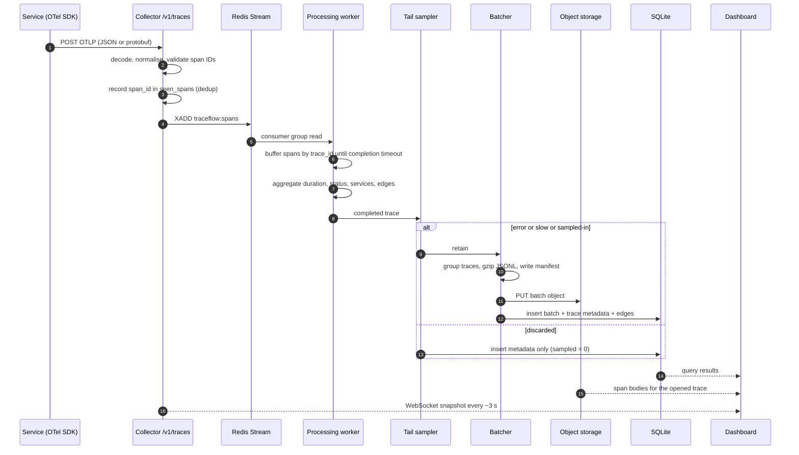
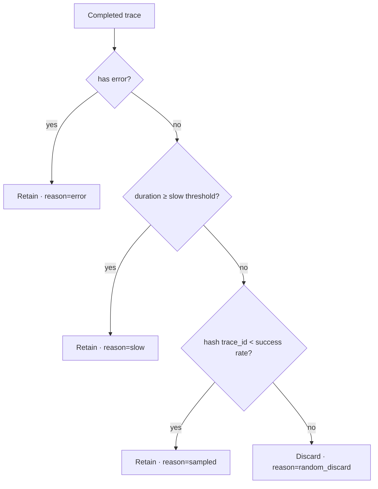

# Data flow

This is the path one trace takes from an instrumented service to the dashboard.

## 1. Ingest

`POST /v1/traces` accepts both OTLP encodings. Protobuf bodies are decoded and the
base64-ish binary trace/span IDs are rendered as hex, matching the JSON form, so a trace
looks identical regardless of exporter encoding. The receiver flattens resource attributes
into span attributes (notably `service.name`) and rejects spans without IDs.

Each accepted span is registered in `seen_spans`. A duplicate span ID is counted and dropped
before it reaches the stream — this is what makes the "Duplicate Telemetry" fault scenario
and replay-after-crash safe.

## 2. Buffer

Accepted spans are added to a Redis Stream with a max length. Ingestion reads the stream as
part of a consumer group, so unacknowledged messages remain visible to `XAUTOCLAIM` if a
worker dies. When Redis is unreachable the buffer reports itself unavailable, spans go to a
bounded spill queue (default 5,000), and the spill worker drains that queue into the stream
once Redis returns. If the spill queue is also full, spans are rejected and counted rather
than silently dropped.

## 3. Aggregate

Spans are held in a per-trace buffer keyed by trace ID. The trace is considered complete when
no new span has arrived for `completion_timeout_s` (default 5 s). Aggregation then computes:

- start/end from the earliest root span (falling back to the span window),
- duration and status (`success`, `error`, `slow`),
- span and service counts, per-service span/error/duration aggregates,
- parent→child service edges with call and error counts,
- waterfall offsets as percentages of the trace duration, plus depth from the span tree.

A span arriving after the decision follows `late_policy`: `drop` increments
`late_span_count`, `accept_if_buffered` merges it into a still-open trace. Neither silently
rewrites a closed trace.

## 4. Sample

The decision, its reason and the retained/discarded flag are stored on the trace row, which is
what the Explorer's decision filter and the Sampling page's breakdown read.

## 5. Batch and store

Retained traces are grouped until `batch_size` (default 100 traces) or `flush_interval_s`
(default 5 s). A batch is serialised as newline-delimited JSON, gzip-compressed, and written
to a date-partitioned key such as
`data/batches/2026/11/10/batch-<epoch>-<rand>.jsonl.gz`.

The upload is retried with exponential backoff; a failed batch keeps its spooled payload and
stays clickable in the Storage table, so "retry" re-uploads the same batch rather than
regenerating it. Trace metadata is attached to the batch only after the upload succeeds.

## 6. Read

Querying traces never touches object storage: filters, sorting and pagination run against
SQLite indexes. Opening a trace finds its `object_key`, streams and decompresses that batch,
and extracts the matching spans. A trace that was discarded still has metadata but no batch,
and the detail page says exactly that instead of showing an empty waterfall.

The WebSocket feed (`/api/ws/live`) recomputes the overview snapshot on a timer and pushes it
to connected dashboards, so the Overview page updates without polling every widget
separately.
