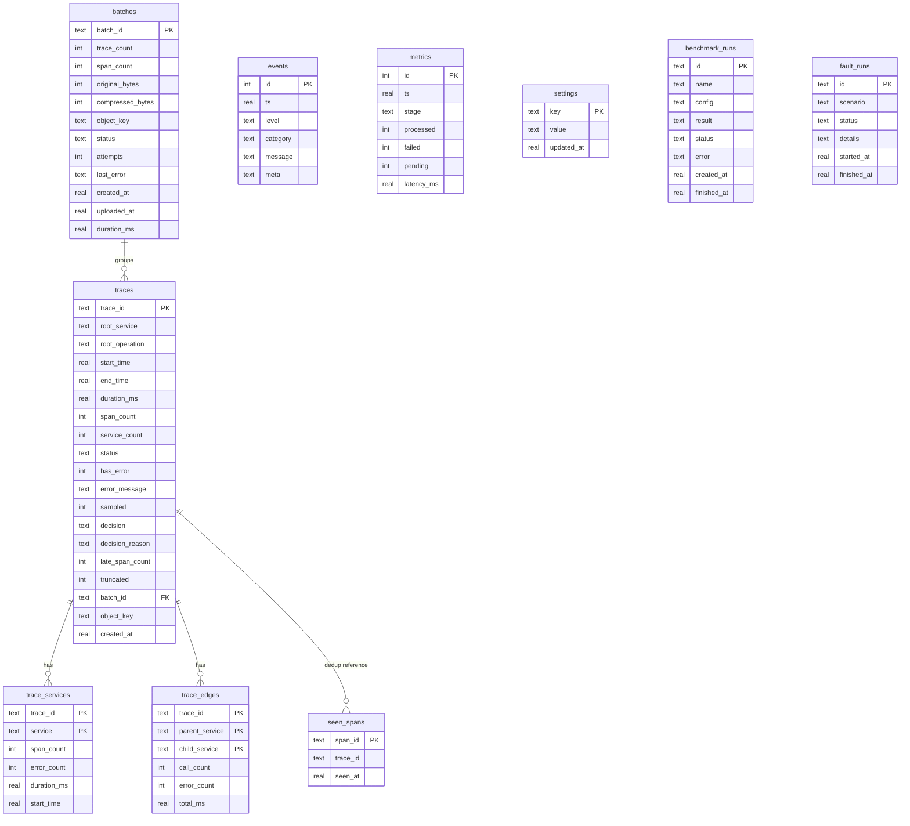

# Storage schema

SQLite stores **searchable metadata only**. Span bodies are never written to SQLite; they live
in gzip JSONL objects in MinIO (or the filesystem fallback).



## Tables

| Table | Purpose |
| --- | --- |
| `traces` | One row per aggregated trace. The Explorer queries this table alone. |
| `trace_services` | Per-trace service participation; powers service filters and service detail. |
| `trace_edges` | Observed parent→child service calls; powers the Service Map. |
| `seen_spans` | Span IDs already accepted, used for idempotent ingest and dedup of replays. |
| `batches` | Manifest for each gzip object: counts, byte sizes, status, attempts, error. |
| `events` | Human-readable activity log shown in the feed and on the Overview. |
| `metrics` | Periodic per-stage rollups used for pipeline latency and health. |
| `settings` | Persisted sampling and batching policy. Survives restarts and is applied at boot. |
| `benchmark_runs` | Config, result JSON, status and timings for measured runs. |
| `fault_runs` | Scenario, status, details/timeline and timings for fault runs. |

## Indexes

| Index | Serves |
| --- | --- |
| `idx_traces_start` (`start_time DESC`) | Default Explorer ordering and range filters |
| `idx_traces_status` (`status, start_time DESC`) | Error/slow filters combined with time |
| `idx_traces_service` (`root_service, start_time DESC`) | Service filter combined with time |
| `idx_traces_batch` | Listing traces belonging to a batch |
| `idx_trace_services_service` | "Traces touching service X" lookups |
| `idx_trace_edges_pair` | Service-map edge aggregation |
| `idx_seen_spans_seen` | Pruning old dedup entries |
| `idx_batches_status` | Batch table filtered by status |
| `idx_events_ts` | Activity feed ordering |
| `idx_metrics_stage_ts` | Latest per-stage metrics |

Trace IDs are the primary key, so a direct lookup is a B-tree seek. Filters that combine
service, status and time use the composite indexes above; free-text `operation` and
`trace_id` prefix filters scan within the narrowed window.

## Object layout

```
data/
  traceflow.db                       SQLite metadata index
  objects/
    data/batches/2026/11/10/
      batch-1794307359641-cbed77.jsonl.gz
```

Each object is newline-delimited JSON with one record per retained trace, compressed with
gzip. The `batches` row stores `object_key`, `original_bytes` and `compressed_bytes`, which is
why the Storage page can show a real compression ratio rather than an estimate. `object_key`
on a trace points at the batch containing its span bodies.

## Retention

Nothing is deleted automatically. Metadata rows and objects accumulate until you remove
`backend/data` (or the `collector-data` volume). For a long-running demo that is the main
reason SQLite size grows, and it is called out in [limitations](limitations.md).
