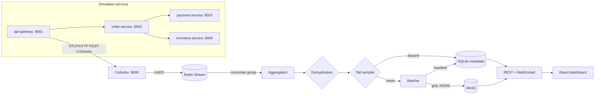

# Micro Project Report

**VIVEKANAND EDUCATION SOCIETY'S INSTITUTE OF TECHNOLOGY**
**DEPARTMENT OF COMPUTER ENGINEERING**

## MICRO PROJECT REPORT

**Project Title:** TraceFlow — Distributed Tracing and Telemetry Intelligence Platform

**SDG Aligned:** SDG 4 (Quality Education), SDG 9 (Industry, Innovation and Infrastructure), SDG 12 (Responsible Consumption and Production)

| Project / Course Details | To be filled by students |
| --- | --- |
| Course / Subject Name | |
| Course Code / Semester / Academic Year | |
| Faculty Incharge / Project Mentor | |
| Project Group No. | |
| Submission Date | |

### Project Team Details

| Student Name | Roll No. | Class / Division | Institute Email ID |
| --- | --- | --- | --- |
| | | | |
| | | | |
| | | | |
| | | | |

**Department of Computer Engineering**
Academic Year: ____________

> This is a sample report prepared from the working project in this repository. Replace the
> cover-page fields and team details with your own before submission.

---

## Abstract

Distributed systems fail in ways that single-service logs cannot explain, and commercial
observability platforms are priced for production fleets rather than a college laboratory.
This project builds TraceFlow, a local-first distributed tracing platform that runs end to
end on one machine: four simulated microservices emit OpenTelemetry spans over OTLP/HTTP, a
custom FastAPI collector buffers them in Redis Streams, aggregates them into traces, applies
tail-based sampling, compresses retained traces into gzip JSONL batches, uploads those
batches to MinIO, and indexes searchable metadata in SQLite. A React dashboard reads every
figure from those services through a REST API and a WebSocket feed; no statistic is
hardcoded. The system also includes a fault-injection laboratory with six real failure
scenarios and a benchmark runner that measures throughput, latency percentiles and
compression on the host machine. Verification consists of 27 automated backend tests
covering OTLP decoding, aggregation, sampling, deduplication, batching, storage and API
filtering, plus a production frontend build. Measured on the development laptop, the
pipeline indexed 480 spans from 120 requests at 4,640 spans/s with a 95th-percentile trace
duration of 1.34 s and 11.3% compressed-to-raw storage. The project demonstrates the
internals of tracing systems and their recovery behaviour rather than acting as a
production APM, and it supports SDG 4 through an inspectable teaching artefact and SDG 12
through aggressive data reduction.

## 1. Introduction

### 1.1 Background and Motivation

Modern applications are decomposed into services that call each other over the network. A
single user request may pass through a gateway, an order service, a payment service and an
inventory service, and when it fails, no individual service log contains the whole story. A
trace solves this by assigning one trace identifier to the request and recording a span for
each unit of work, with parent-child links, timings, status and attributes. Dapper described
this model at Google [1]; OpenTelemetry now standardises the data model, the wire protocol
(OTLP) and the propagation format [2], [3], [4].

The course concepts applied here are distributed systems design, message-queue based
decoupling, idempotency, backpressure, tail-based sampling, columnar/object storage
trade-offs, and API-driven visualisation. The motivation is practical: tracing platforms are
usually consumed as black boxes, so students learn to read dashboards without learning why
spans are dropped, why storage shrinks, or what happens when the buffer is unavailable. A
small system that can be run, broken and measured on a laptop makes those mechanisms
visible.

### 1.2 Problem Context

A typical student project collects logs with `print` statements or ships metrics to a hosted
service. Both approaches hide the pipeline. Existing open-source stacks (Jaeger, Zipkin,
Grafana Tempo) are excellent but heavy to operate and difficult to modify for coursework:
the sampling policy, the batch format and the recovery path are buried in production code.
Commercial platforms solve the problem for enterprises but not for a laboratory with no
budget, no cloud account and no data-governance approval. The gap is a system small enough
to read in a semester, complete enough to demonstrate real tracing behaviour, and open
about its own limitations.

### 1.3 Intended Users / Stakeholders

- **Students and faculty** studying distributed systems, observability or cloud computing,
  who need an inspectable reference implementation.
- **Developers learning OpenTelemetry**, who want to see what a collector does with spans
  after they are exported.
- **Laboratory administrators**, who need a workload that runs offline with no paid accounts
  and no external data transfer.
- **The project team**, who use the fault laboratory and benchmarks to evaluate design
  decisions.

## 2. Problem Definition, Objectives and Scope

### 2.1 Problem Statement

Build a self-contained tracing platform that ingests OpenTelemetry spans from multiple
services, reconstructs complete traces, applies a configurable retention policy, stores trace
bodies compactly, exposes a queryable index, and visualises the result in a dashboard whose
every value originates from the backend. The system must survive buffer and storage
failures without silently losing or duplicating telemetry, and it must let a user reproduce
those failures and measure the cost of the pipeline on the local machine.

### 2.2 Objectives

1. **Design** an OTLP-compatible ingestion path that accepts both JSON and protobuf exports.
2. **Develop** a collector that aggregates out-of-order spans into traces and closes them
   after a completion window.
3. **Implement** a tail-based sampler with configurable error, slow and success rates, and a
   defined late-span policy.
4. **Implement** deduplication and bounded buffering so that replays and outages do not
   duplicate or unboundedly buffer telemetry.
5. **Store** retained traces as compressed batch objects and index searchable metadata in
   SQLite, keeping span bodies out of the index.
6. **Build** a dashboard covering overview, live traces, search, trace detail, service map,
   pipeline, sampling, storage, faults and benchmarks, with no hardcoded statistics.
7. **Evaluate** the system with automated tests, six fault scenarios and measured load runs,
   and **document** the results including limitations.

### 2.3 Scope and Deliverables

**Included:** four simulated services; a collector with five supervised workers; Redis
Streams buffering with an in-process fallback; MinIO object storage with a filesystem
fallback; a SQLite metadata index with ten tables; a JSON/protobuf OTLP receiver; a
configurable sampling and batching policy; a fault-injection API and UI; a benchmark runner
with four comparison experiments; a React dashboard with nine routed pages plus trace
detail; automated tests; and documentation.

**Excluded:** authentication and multi-tenancy, TLS, horizontal scaling, real cloud
deployment, alerting integrations, log correlation, and long-term retention policies.

**Deliverables:** the source repository, this report, the API reference, architecture and
data-flow documentation, and a live demonstration on a local machine.

### 2.4 Assumptions and Constraints

- The system runs on a single node; Redis and MinIO are optional and are replaced by
  documented fallbacks when absent.
- All traffic is generated locally; the synthetic-traffic and fault endpoints reject
  non-loopback callers.
- No personal or production data is processed. The services are simulations.
- The project is bounded by one academic semester and one development laptop running
  Windows, Python 3.11 and Node 24.
- Docker is not installed in the development environment, so container definitions are
  provided but were not executed during evaluation.

## 3. Background / Literature Review

| Source / Year | Approach or Key Finding | Strength / Limitation | Relevance to This Project |
| --- | --- | --- | --- |
| Sigelman et al., Dapper, 2010 [1] | Trace trees of spans with sampling and a scan-friendly index | Foundational model; Google-specific infrastructure | Informed the trace/span model and the two-tier storage split |
| OpenTelemetry Specification, 2024 [2] | Vendor-neutral API, SDK and data model for traces, metrics and logs | Comprehensive; large surface area | Defines the span fields, status codes and resource attributes used here |
| W3C Trace Context, 2021 [3] | `traceparent`/`tracestate` headers for cross-service propagation | Simple and widely adopted; no payload semantics | Explains how the gateway and its downstream calls share one trace ID |
| OpenTelemetry Protocol (OTLP), 2024 [4] | Protobuf and JSON encoding of telemetry over gRPC/HTTP | Standard; requires careful binary ID handling | The receiver accepts both encodings and decodes binary IDs to hex |
| Redis Streams documentation [5] | Append-only streams with consumer groups, pending lists and claiming | Durable and simple; memory-bound without trimming | Used for buffering, `MAXLEN` bounding and crash recovery via `XAUTOCLAIM` |
| FastAPI documentation [6] | Async Python web framework with Pydantic validation | Fast to develop; single-process by default | Collector API, WebSocket feed and the four simulated services |
| SQLite documentation [7] | Embedded relational database, single writer | Zero administration; not a time-series store | Metadata index for traces, services, edges and batches |
| MinIO documentation [8] | S3-compatible object storage | Standard API; extra service to operate | Batch storage, with a filesystem backend for offline use |
| OpenTelemetry sampling guidance [9] | Head versus tail sampling trade-offs | Practical; platform-specific advice | Justifies deciding after trace completion and keeping errors/slow traces |

### 3.1 Identified Gap and Project Contribution

The literature explains tracing at production scale, and the tools implement it at
production scale. What is missing is a compact implementation where the retention decision,
the batch format, the recovery path and the failure behaviour are all visible and
modifiable. TraceFlow contributes that: a collector of roughly a few thousand lines with a
deliberately explicit pipeline, a fault laboratory that drives real counters rather than
scripted output, and a dashboard bound only to those APIs. It is an educational and
engineering artefact, not a novel research contribution.

## 4. Proposed Solution and System Design

### 4.1 Proposed Solution

TraceFlow separates the write path from the read path. Spans are written once, appended to a
bounded stream, aggregated in memory, decided by the sampler, and persisted as compressed
batch objects; only metadata is indexed for search. The dashboard reads the index for lists
and aggregates, and fetches a batch object only when a user opens a retained trace. This
keeps the index small while preserving full fidelity for the traces that matter, and it makes
the storage trade-off measurable.

Users interact through the dashboard: generate traffic, watch traces arrive live, search and
inspect a trace waterfall, adjust the sampling policy and observe retention change, inspect
batches and compression, trigger a failure scenario and verify recovery, then run a benchmark
and compare variants.

### 4.2 System Architecture



**Figure 1: End-to-end architecture.** The gateway and three downstream services instrument
their HTTP handlers with OpenTelemetry and export to the collector. The collector owns five
supervised workers (ingestion, processing, storage, spill, metrics) in one process. Redis
Streams decouple ingestion from aggregation; SQLite holds only searchable metadata; MinIO
holds compressed span bodies.

### 4.3 Module Description

| Module / Component | Responsibility | Input | Output |
| --- | --- | --- | --- |
| OTLP receiver | Parse JSON/protobuf exports, normalise IDs, validate | OTLP request | `Span` objects |
| Ingestion service | Deduplicate, enqueue, spill on buffer failure | Spans | Stream entries, counters |
| Buffer layer | Bounded stream, consumer group, pending recovery | Entries | Batches of entries |
| Aggregation | Group spans by trace, compute duration, services, edges | Spans | `TraceSummary` |
| Sampler | Decide retention after the completion window | Trace summary | Decision + reason |
| Batcher | Group retained traces, gzip, write-ahead spool | Trace summaries | Batch objects |
| Storage worker | Upload batches with retry and backoff | Batch | Object key, manifest |
| Indexer | Persist trace metadata, services, edges, batches | Manifest | SQLite rows |
| API layer | Serve dashboard queries and mutations | HTTP | JSON |
| Live feed | Push a snapshot every three seconds | WebSocket | Snapshot JSON |
| Dashboard | Render pages from API data | JSON | UI |
| Fault controller | Run six failure scenarios and record outcomes | Scenario | Timeline + metrics |
| Benchmark runner | Generate load, drain, read back metrics | Config | Measured result |

### 4.4 Data / Inputs

There is no external dataset. Inputs are (a) spans exported by the four simulated services
during a real HTTP flow, and (b) synthetic traces generated by the collector for
demonstrations, faults and benchmarks. Each synthetic trace contains four spans across the
gateway, order, payment and inventory services, with configurable error and slow
probabilities. Trace IDs are 32 hex characters and span IDs 16 hex characters, matching the
OTLP specification. Attributes include HTTP method, route, status code and selected business
fields. No personal data is used.

### 4.5 Algorithm and Design Decisions

**Tail-based sampling.** A trace is decided only after it stops receiving spans for
`completion_timeout_s`. Errors are retained at `error_rate`, traces above
`slow_threshold_ms` are always retained, and successful traces are retained at
`success_rate`. When `deterministic` is on, the score is `BLAKE2b(trace_id) / 2^64`, so the
same trace always receives the same verdict.

```
on trace completion:
    if trace.has_error:      keep with probability error_rate
    elif trace.duration >= slow_threshold: keep
    else:                    keep with probability success_rate
    record decision and reason
```

**Deduplication.** Span IDs are inserted into a `seen_spans` table on ingest; a duplicate is
counted and dropped before aggregation. Because the record is in SQLite rather than memory,
deduplication survives a collector restart, which is what makes crash replay safe.

**Batching and compression.** Retained traces accumulate until `batch_size` or
`flush_interval_s` is reached. The batcher writes a gzip JSONL file to a spool directory
first, then hands it to the storage worker. Upload retries use exponential backoff, and the
spool file remains the recovery source if the process dies before the upload succeeds.

**Retrieval.** The index stores duration, status, services, edges and the object key. Opening
a trace fetches the batch, decompresses it and rebuilds the waterfall with computed depth and
offset. Discarded traces return metadata plus an explicit warning instead of span bodies.

## 5. Methodology and Implementation

### 5.1 Workflow

1. Requirements and scope: define the pipeline stages, the retention policy and the pages.
2. Backend vertical slice: OTLP receiver, buffer, aggregation and index, verified by tests.
3. Storage layer: batching, spool, compression, upload and retrieval.
4. Sampling and deduplication with unit tests for decision boundaries.
5. API surface and WebSocket feed, then the dashboard page by page against live data.
6. Fault laboratory and benchmark runner, each verified through its own API and the UI.
7. Documentation, container definitions and final regression run.

### 5.2 Technologies, Tools and Resources

| Category | Technology / Tool | Purpose / Justification |
| --- | --- | --- |
| Language / framework | Python 3.11, FastAPI 0.115.6, Pydantic 2.10 | Async API and strict validation |
| Telemetry | OpenTelemetry SDK 1.29, OTLP HTTP exporter | Standard span generation and export |
| Buffer | Redis 5.2 client, Redis Streams | Consumer groups and pending-entry recovery |
| Storage | MinIO 7.2 client, SQLite via aiosqlite 0.20 | Object bodies plus a lightweight index |
| Frontend | React 18.3, Vite 6, Tailwind CSS 3.4, Recharts 2.15, React Flow 11 | Dashboard, charts and service graph |
| Testing | pytest 8.3, pytest-asyncio 0.25 | Automated backend verification |
| Load testing | Locust 2.32 | Optional HTTP load profile |
| Runtime | Windows laptop, Node 24.12, npm 11.6 | Single-node evaluation |

### 5.3 Implementation Details

The collector is created by a factory that accepts a runtime override and a worker flag, so
tests can run the real application without background tasks. Startup performs crash recovery
before declaring readiness: pending stream entries are claimed and replayed, and batches left
in `pending` are re-uploaded.

OTLP protobuf encodes trace and span identifiers as raw bytes, while the JSON encoding uses
hex strings. The decoder normalises both to lowercase hex; without this, protobuf spans were
stored under a different identifier than the one used by search, and detail lookups returned
404. The integration test now sends a real protobuf export and asserts the lookup by hex ID.

The buffer abstraction exposes `read_batch`, `ack`, `pending_count` and `simulate_outage`, so
the Redis backend and the in-memory fallback are interchangeable and the fault laboratory can
inject an outage without touching worker code. Ingestion catches buffer errors, increments a
counter and pushes the span into a bounded spill queue; a spill worker drains that queue back
into the stream when the buffer recovers.

The frontend is a single-page application routed with React Router. All requests are relative
to `/api`, which Vite proxies to the collector in development and nginx proxies in the
container image. The overview seeds from REST and then applies WebSocket snapshots; other
pages poll at 2.5 to 5 seconds. Charts are driven by the API response, including empty states,
so a window with no data shows zeros rather than sample values.

### 5.4 User Interface

The dashboard uses a three-column layout: a 256 px navigation rail, a flexible main area and a
320 px activity panel, collapsing to drawers on narrow screens.

| Page | Demonstrated Function |
| --- | --- |
| Overview | Totals, error rate, latency percentiles, sampling rate, throughput, service health, recent traces and events |
| Live Traces | Trace tail refreshed every 2.5 s, ingest counters, buffer depth, worker states |
| Trace Explorer | Server-side filters for ID, service, operation, status, duration and time range, with sorting and pagination |
| Trace Detail | Sampling decision, waterfall, span attributes and events, link to the storage batch |
| Service Map | Graph from observed parent-child edges, inbound/outbound calls, top operations |
| Telemetry Pipeline | Stage counters and latency from ingest to index |
| Sampling Engine | Live policy editor, retention breakdown, storage-reduction estimate, recent decisions |
| Storage & Indexing | Compressed versus raw bytes, batch table with retry, batching policy, object inspection |
| Fault Injection | Six scenarios with timelines and measured recovery results |
| Benchmarks | Load configuration, measured metrics and four comparison experiments |

### 5.5 Team Contribution

| Team Member | Assigned Responsibility | Work Completed / Evidence |
| --- | --- | --- |
| (to be filled) | Backend pipeline | OTLP receiver, buffer, aggregation, sampler, batching, index |
| (to be filled) | Storage and reliability | Compression, spool, retries, deduplication, recovery |
| (to be filled) | Frontend | Ten pages, API client, charts, service graph, responsive shell |
| (to be filled) | Evaluation and documentation | Tests, fault scenarios, benchmarks, documentation set |

## 6. Testing, Evaluation and Results

### 6.1 Test Plan and Test Cases

The backend suite runs the real FastAPI application against the in-memory stream and
filesystem object store, with a temporary SQLite database. Asynchronous uploads are handled
by polling helpers with timeouts rather than fixed sleeps.

| Test ID | Test Input / Scenario | Expected Result | Observed Result | Status |
| --- | --- | --- | --- | --- |
| TC-01 | Two-resource OTLP JSON trace | Aggregated, retained, uploaded, retrievable with spans | 2 spans, object key present, no warning | Pass |
| TC-02 | OTLP protobuf export with binary IDs | Accepted and searchable by hex ID | Trace found, 1 span retained | Pass |
| TC-03 | `success_rate = 0`, successful trace | Metadata only, body discarded | `sampled = false`, no object key, warning shown | Pass |
| TC-04 | Slow and error traces with low success rate | Slow above threshold and errors retained | Reasons `slow` and `error` recorded | Pass |
| TC-05 | Six traces, page size 2, sorted by duration | Correct totals, pages and ordering | Total 6, pages 3, two items per page | Pass |
| TC-06 | Duplicate span submitted twice | Stored `span_count` stays 1 | 1 span persisted | Pass |
| TC-07 | Invalid sampling rate and malformed OTLP body | 422 and 400 respectively | 422 and 400 returned | Pass |
| TC-08 | Fault run: Redis disconnection | Spill, drain, no rejection | 160 spilled, 160 flushed, 0 rejected, recovery verified | Pass |

### 6.2 Evaluation Metrics

| Metric | Measurement Method / Formula | Observed Value | Interpretation |
| --- | --- | --- | --- |
| Test pass rate | `pytest` summary | 27/27 (100%) | All automated checks pass |
| Ingestion throughput | Indexed spans / load duration | 4,640 spans/s | Collector keeps up with synthetic load |
| Trace latency p95 | 95th percentile of indexed trace durations | 1.34 s | Tail latency reflects injected slow traces |
| Storage compression | Compressed bytes / original bytes | 11.3% | Retained traces occupy about one ninth of raw size |
| Sampling retention | Retained / evaluated traces in the window | 32.22% (29 of 90) | Errors and slow traces dominate retention |
| Fault recovery time | Wall clock from outage end to drain | 1,984.7 ms | Spill buffer drains promptly after recovery |
| Frontend build | `vite build` output | 2,118 modules, 947 kB (274 kB gzipped) | Production build succeeds |

### 6.3 Results and Discussion

A measured benchmark run of 120 requests at concurrency 10 generated 480 spans. The
collector stored 58 traces, of which 11 were sampled for body storage, at 4,640 spans/s with
an average trace duration of 275 ms, p95 of 1.34 s and p99 of 1.37 s. The error rate was 3.5%,
matching the configured 5% error probability within sampling variance. Storage for the run
was 2.8 kB compressed at 11.3% of raw size with a single batch write, confirming that
batching and gzip both reduce object count and bytes.

A separate 90-trace window reported 90 traces, 360 spans, 10.0% error rate, 1,209.7 ms p95
and 32.22% retention. The difference between runs is expected: retention depends on the mix
of error and slow traces, which is generated randomly.

The Redis disconnection scenario produced 160 spilled spans, all 160 flushed after recovery,
zero rejections and a measured recovery of about 1.98 s. A storage outage run left no
unrecovered batches, and the collector crash scenario showed replayed messages consumed
without duplicate persistence. Compression against the full store was 10.15% (343,541 raw
bytes to 34,857 compressed) across eight batches.

Unexpected observations are documented rather than hidden. A benchmark run executed before
the collector restart reported a request count of zero because the window filter excluded
older rows; the page now explains the measured window. The memory buffer also resets pending
state on restart, so crash recovery is only meaningful for the Redis backend, and this is
stated in the limitations.

### 6.4 Validation Evidence

- `python -m pytest` in `backend/`: 27 passed, exit code 0.
- `npm run build` in `frontend/`: build completed, exit code 0, 2,118 modules transformed.
- All 31 documented API paths matched the live OpenAPI schema at `/api/openapi.json`.
- The dashboard was exercised in a browser against the running collector: each page was
  loaded with live data, a fault scenario was triggered from the UI, and a benchmark was run
  and read back, with no application console errors.

## 7. Sustainability and SDG Alignment

### 7.1 Sustainability Assessment

| Dimension | Questions to Consider | Project-Specific Assessment / Evidence |
| --- | --- | --- |
| Environmental | Energy and compute use; resource efficiency; e-waste | Negative but bounded: one laptop for the demo, no cloud GPUs. Positive: sampling and compression cut stored bytes to about 11% of raw, directly reducing disk and backup load. The system runs offline, avoiding network transfer. |
| Social | Accessibility, privacy, digital divide, community benefit | Positive: free, offline, inspectable teaching tool usable without paid accounts. No personal data is collected; all telemetry is synthetic. Accessibility is partial: keyboard navigation works, but charts lack a tabular alternative. |
| Economic | Development and operating cost, maintenance, affordability | Zero recurring cost. No licences, no cloud bill; runs on hardware students already own. Maintenance is limited to dependency updates because the stack is small. |

### 7.2 UN Sustainable Development Goals

| SDG No. and Name | Project Feature / Activity Linked to SDG | Expected or Observed Contribution | Evidence / Indicator |
| --- | --- | --- | --- |
| SDG 4: Quality Education | Open, runnable tracing pipeline with documented internals and a fault laboratory | Lets students observe sampling, batching and recovery instead of reading about them | Full source, 27 automated tests, eight documents, reproducible local demo |
| SDG 9: Industry, Innovation and Infrastructure | Standards-based ingestion (OTLP, W3C Trace Context) and a modular pipeline | Demonstrates how observability infrastructure is assembled from standard components | OTLP JSON and protobuf both accepted; service graph built from real edges |
| SDG 12: Responsible Consumption and Production | Tail sampling plus gzip batching and a metadata-only index | Reduces storage per trace substantially and avoids retaining data with no diagnostic value | 11.3% and 10.15% compression measured; 32.22% retention in a sampled window |
| SDG 13: Climate Action (indirect) | Local-first operation and reduced storage footprint | Avoids cloud compute and repeated data transfer for coursework | No cloud dependency; single-node runtime |

SDG 13 is listed only as an indirect link; the project does not measure emissions, so no
quantified climate claim is made.

### 7.3 Sustainability Measures and Trade-offs

The primary measure is data minimisation: errors and slow traces are kept, successful traces
are sampled, and bodies are compressed before storage. The trade-off is diagnostic
completeness, since discarded traces cannot be inspected later. A second measure is
local-first execution, which removes network transfer and cloud cost at the price of
scalability. A third is bounded buffering, which protects memory during outages but rejects
spans when the spill queue is full; the rejection is counted and surfaced rather than hidden.

### 7.4 Sustainability Indicator / Follow-up

Proposed future indicators: bytes stored per thousand traces before and after sampling,
kilowatt-hours per benchmark run measured with a wall meter, and the share of traces whose
bodies are retrievable when a user opens them. The first two are not measured in this micro
project and are labelled as future work.

## 8. Feasibility, Limitations and Risk Considerations

### 8.1 Feasibility

Technical feasibility is demonstrated by the working system and its tests. Time feasibility
was acceptable because each pipeline stage was built and verified independently. Operational
feasibility is good for a laboratory: two commands start the system, and no credentials are
required. Cost is effectively zero because the stack is open source and runs on existing
hardware.

| Item / Resource | Estimated Cost (₹) | Basis / Notes |
| --- | --- | --- |
| Hardware / hosting | 0 | Existing laptop; no cloud instances |
| Software / libraries | 0 | All dependencies are open source |
| Electricity | 0–300 | Order-of-magnitude estimate for development hours on a laptop |
| Total estimated cost | 0–300 | One-time; no recurring service fees |

### 8.2 Limitations

- Single process and single node: no horizontal scaling, no leader election, no sharding.
- SQLite is a metadata index, not a time-series database; percentile queries scan the window.
- Sampling state and the in-memory buffer are per process; restarts lose decision counters.
- Fault injection is in-process and does not kill containers or drop TCP connections.
- Benchmarks measure one laptop with nearest-rank percentiles over a few hundred samples.
- Container and Locust definitions were authored but not executed, because Docker is not
  installed in the development environment.
- No authentication, TLS or multi-tenancy; the API is intended for loopback use only.
- The frontend is a single 947 kB bundle with no code splitting and no automated browser
  tests.

### 8.3 Risks, Ethics, Privacy and Security

The main security risk is unintended exposure of an unauthenticated API. Mitigations are
loopback-only binding, CORS restricted to local origins, and explicit `403` responses for
synthetic traffic and fault injection from non-loopback addresses. No credentials or personal
data are stored; the collector processes only synthetic telemetry. Ethical risks are limited
to misinterpretation: benchmark numbers describe one machine and must not be presented as
production capacity, which the documentation states explicitly. There is no AI model in the
system, so bias and explainability concerns do not apply. Reliability risks, such as silent
data loss, are addressed by counting rejections, exposing worker state and verifying recovery
with measured counters rather than assumed success.

## 9. Conclusion and Future Scope

### 9.1 Summary

TraceFlow implements a complete distributed tracing pipeline on a single machine: OTLP
ingestion, bounded buffering, trace aggregation, tail-based sampling, deduplication,
compressed batch storage, SQLite indexing, a REST and WebSocket API, and a dashboard that
reads every value from those services. All seven objectives were met and verified by 27
automated tests, a successful production build, six fault scenarios and measured benchmark
runs. The most important results are 4,640 spans/s ingestion, 1.34 s p95 trace duration,
roughly 11% compressed-to-raw storage, and recovery from a buffer outage with zero spill
rejections. The project supports SDG 4 by making tracing internals inspectable, SDG 9 by
applying standard telemetry protocols, and SDG 12 by retaining only data with diagnostic
value. Its limitations, especially single-node scope and unexecuted container definitions,
are documented rather than concealed.

### 9.2 Future Scope

1. Replace SQLite percentile scans with a purpose-built time-series store or pre-aggregated
   rollups.
2. Add authentication, per-user isolation and TLS for non-loopback deployments.
3. Scale the collector horizontally with partitioned streams and shared sampling state.
4. Validate the Docker Compose stack and run the Locust profile as part of continuous
   integration.
5. Add browser automation and visual regression tests for the dashboard.
6. Extend the fault laboratory to process-level crashes and network partitions.
7. Measure energy per benchmark run to substantiate the sustainability indicators.

## References

[1] B. H. Sigelman, L. A. Barroso, M. Burrows, P. Stephenson, M. Plakal, D. Beaver, S. Jaspan,
and C. Shanbhag, "Dapper, a Large-Scale Distributed Systems Tracing Infrastructure," Google
Technical Report dapper-2010-1, 2010.

[2] OpenTelemetry Authors, "OpenTelemetry Specification," 2024. [Online]. Available:
https://opentelemetry.io/docs/specs/otel/

[3] W3C, "Trace Context," W3C Recommendation, 2021. [Online]. Available:
https://www.w3.org/TR/trace-context/

[4] OpenTelemetry Authors, "OpenTelemetry Protocol Specification," 2024. [Online]. Available:
https://opentelemetry.io/docs/specs/otlp/

[5] Redis Ltd., "Redis Streams," Redis Documentation, 2024. [Online]. Available:
https://redis.io/docs/latest/develop/data-types/streams/

[6] S. Ramirez, "FastAPI Documentation," 2024. [Online]. Available:
https://fastapi.tiangolo.com/

[7] SQLite Consortium, "SQLite Documentation," 2024. [Online]. Available:
https://www.sqlite.org/docs.html

[8] MinIO Inc., "MinIO Documentation," 2024. [Online]. Available:
https://min.io/docs/minio/linux/index.html

[9] OpenTelemetry Authors, "Sampling," OpenTelemetry Documentation, 2024. [Online].
Available: https://opentelemetry.io/docs/concepts/sampling/

[10] React Team, "React Documentation," 2024. [Online]. Available:
https://react.dev/

## Appendices

### Appendix A: Running the System

```bash
# Collector
cd backend
./.venv/Scripts/python.exe -m uvicorn app.main:app --host 127.0.0.1 --port 8000

# Dashboard
cd frontend
npm install
npm run dev
```

With Redis and MinIO available, no environment overrides are needed. Without them, set
`BUFFER_BACKEND=memory` and `OBJECT_STORE_BACKEND=filesystem`, or accept the fallback after
the startup retry window.

### Appendix B: API Surface

The collector exposes 31 documented paths. Principal groups: ingestion (`POST /v1/traces`,
`POST /api/telemetry/traffic`), dashboard (`/api/dashboard/overview`, `/api/dashboard/timeseries`),
traces (`/api/traces`, `/api/traces/{trace_id}`), services, pipeline, sampling, batches,
storage, events, faults, benchmarks and the WebSocket feed at `/api/ws/live`. The live schema
is served at `/api/openapi.json` and the interactive documentation at `/api/docs`.

### Appendix C: Test and Build Commands

```bash
cd backend && ./.venv/Scripts/python.exe -m pytest
cd frontend && npm run build
```

### Appendix D: Demonstration Notes

The demonstration runs entirely on localhost: collector on port 8000, dashboard on 5173, and
the four simulated services on 8001 to 8004. No credentials, tokens or private data are
required or included. Logs are written to the console in JSON format.
